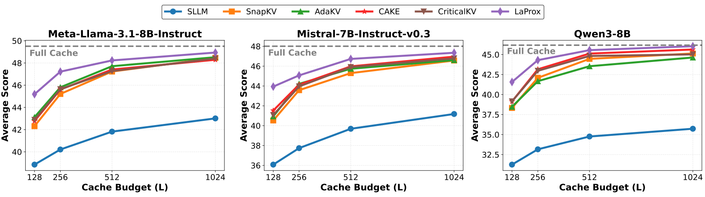

<h1 align="center">
  LaProx: Reformulating KV Cache Eviction Problem for Long-Context LLM Inference
</h1>

<p align="center">
  <strong>Tho Mai</strong>, <strong>Joo-Young Kim</strong>
</p>

<p align="center">
  <a href="https://arxiv.org/abs/2605.07234"></a>
  <!-- <a href="https://vaisr.github.io/OVGGT"></a> -->
  <a href="https://neurips.cc/virtual/2026/loc/sydney/poster/153767"></a>
</p>

## 🔥 News
- **2026-10:** 🎉🎉🎉 LaProx is accepted at NeurIPS 2026!
- **2026-05:** Paper released on [arXiv](https://arxiv.org/abs/2605.07234).
- **2026-01:** First paper released.

## 📖 Overview

We propose **LaProx**,  an unified eviction strategy that assigns globally comparable importance scores to tokens, enabling model-wide selection instead of local, head-wise decisions. It explicitly models the multiplicative interaction between attention maps and projected value states to accurately quantify token contributions while accounting for inter-head dependencies.

Our main contributions are summarized as follows:

1. We demonstrate that attention weights alone provide an incomplete measure of token importance, and accurate selection must account for output information and attention layer’s structure itself.
2. We reveal that existing independent head-wise eviction is suboptimal because it neglects inter-head and inter-layer interactions, and show that eviction should be done at the model-level.
3. We introduce Layer Approximated Cache (LaProx), a new eviction strategy that approximates layer’s output by evaluating tokens across heads and layers simultaneously without any calibration.
4. Extensive evaluations on long-context benchmarks demonstrate that the proposed method consistently outperforms attention-based eviction strategies, confirming the effectiveness of our proposal.

<div align="center">
    
</div>

## 🔧 Installation

1. Clone LaProx
```bash
git clone https://github.com/huuthomai/LaProx.git
cd LaProx
```

2. Create conda environment
```bash
conda create -n conda_LaProx python=3.10
conda activate conda_LaProx
```

3. Install requirements
```bash
pip install -r requirements.txt
```

## 🧪 Evaluation

Run the commands below from the repository root, with LongBench data in `data/LongBench/<dataset>.jsonl` and access to the selected model. Replace the `<...>` placeholders with your settings.

1. **Generate predictions.**

Run the provided script to evaluate FullKV, SnapKV, and LaProx on both Llama and Mistral with cache budgets of 128, 256, 512, and 1024. Predictions are saved under `results_long_bench`.

```bash
bash eval_longBench.sh <gpu_id>
```

Alternatively, run an individual configuration:

```bash
CUDA_VISIBLE_DEVICES=<gpu_id> python run_longbench_new.py \
    --method <method> \
    --model_path <model_path> \
    --max_capacity_prompts <cache_budget> \
    --save_dir <save_dir>
```

- `<gpu_id>`: GPU index, such as `0`.
- `<method>`: Eviction method (e.g., `FullKV`, `SnapKV`, or `LaProx`).
- `<model_path>`: Hugging Face model ID or local model directory (e.g., `meta-llama/Meta-Llama-3.1-8B-Instruct` or `mistralai/Mistral-7B-Instruct-v0.3`.)
- `<cache_budget>`: Average KV cache budget per head (e.g., `128`, `256`, `512`, or `1024`).
- `<save_dir>`: Output directory for predictions, such as `results_long_bench`.

Add `--max_num_examples <num_examples>` to limit examples per task for a quick run.

2. **Compute evaluation scores.**

```bash
python eval.py \
    --results_dir <save_dir>/<model_name>_<cache_budget>
```

Use the prediction directory for the model and cache budget you want to score. `<model_name>` is the final component of `<model_path>`, such as `Meta-Llama-3.1-8B-Instruct`; `<save_dir>` is `results_long_bench` when using the shell script. Run this command for each model and cache budget. Scores are saved to `results.csv` in the corresponding directory. Entries without predictions are reported as `-1`.

## TODO:

- [ ] Upgrade Transformers for more models support


## Citation

If you find **LaProx** useful for your research and applications, please kindly cite using this BibTeX:

```latex
@misc{mai2026reformulatingkvcacheeviction,
      title={Reformulating KV Cache Eviction Problem for Long-Context LLM Inference}, 
      author={Tho Mai and Joo-Young Kim},
      year={2026},
      eprint={2605.07234},
      archivePrefix={arXiv},
      primaryClass={cs.CL},
      url={https://arxiv.org/abs/2605.07234}, 
}
```

## Acknowledgement

Thanks [KVCache-Factory](https://github.com/Zefan-Cai/KVCache-Factory), [CAKE](https://github.com/antgroup/cakekv), and [AdaKV](https://github.com/FFY0/AdaKV) for providing open-source code to support the expansion of this project.
